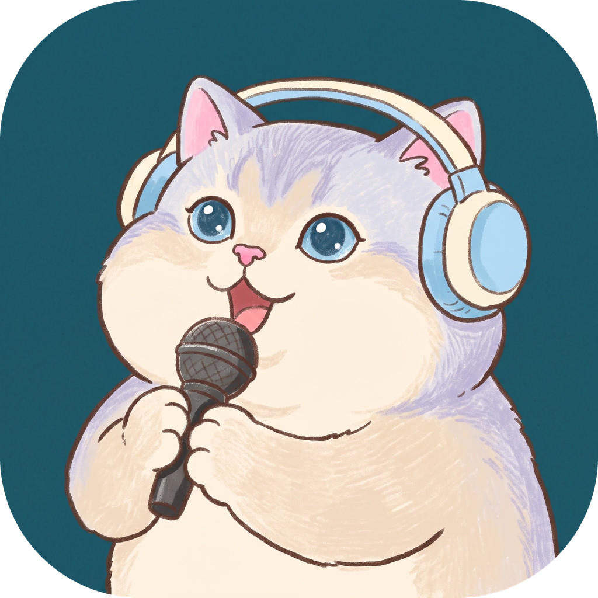
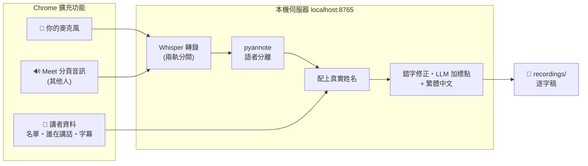

<div align="center">



# GMScribe

**把 Google Meet 會議變成「每一句都知道是誰說的」繁體中文逐字稿**
**全部在你自己的 Mac 上完成:不上雲、不用 API 金鑰、不用訂閱**


</div>

```
[王小明] 好,那我們開始。上週的登入頁改版,前端那邊進度如何?
[Amy Lin] Landing Page 已經上到測試機了,剩下 Code Review 的意見還在改。
[陳大文] 我補充一下,API 那邊週三前會好,到時候再一起測。
```

> [!IMPORTANT]
> **使用前請先閱讀 [⚖️ 使用聲明與法律責任](#legal)。**這個工具錄音時,其他與會者畫面上**不會**出現任何錄音提示,
> 是否合法、是否需要取得同意,由使用者自行確認並承擔責任。

---

## ✨ 功能特色

| | 功能 | 說明 |
|---|---|---|
| 🧑‍🤝‍🧑 | **每一行標出真實姓名** | 自動讀 Meet 的與會者名單、字幕上的講者名字和每個人的靜音狀態,20 幾人的站立會議也能分清楚誰在講話,不是「講者 1、講者 2」 |
| 🔀 | **不用選會議模式** | 輪流報告的站立會議、你一言我一語的自由討論,同一套流程都能處理;短短一句插話也能分對人 |
| 🌏 | **中英夾雜也聽得懂** | Whisper `large-v3-turbo`,專有名詞、工具名稱、工單編號照原樣保留 |
| ✍️ | **自動潤飾成好讀的文字** | 本機 LLM 補標點,原話一個字都不改(AI 換掉的字不採用);簡轉繁只轉字、不換詞,「優化」不會被改成「最佳化」 |
| 🧹 | **擋掉雜音亂碼** | 語音辨識沒把握的片段(雜音被猜成「山脊 rég 怕痛」這類亂碼)和已知的影片字幕幻覺句不會進逐字稿,另外存一份可以檢查 |
| 📖 | **固定錯字對照表** | 同事名字、內部用語老是被聽錯?寫進對照表,之後每份逐字稿自動修正。另外內建常見技術名詞的修正(例如 `Coreview` → `Code Review`) |
| 🐢 | **潤飾不卡電腦** | 潤飾時可以在 popup 調整速度,預設最省資源;上下限依電腦當下的記憶體與 CPU 狀況自動決定 |
| 🙈 | **字幕、名單要不要顯示由你決定** | 辨識講者需要的字幕和與會者名單會自動打開;要不要在畫面上藏起來,在擴充功能裡勾選 |
| 🚦 | **不用點開也看得到狀態** | 工具列圖示上的小標籤會顯示錄音中、上傳中、處理進度、完成或錯誤 |
| 🔘 | **一鍵開關伺服器** | 從擴充功能的 popup 直接啟動/關閉本機伺服器,伺服器沒開時不能開始錄音,避免白錄 |
| 💾 | **錄音不會遺失** | 上傳失敗時錄音先保存在瀏覽器裡,一鍵重新上傳 |
| 📝 | **一句話整理成會議紀錄** | 內附 Claude Code skill:產出會議大綱、決議、待辦事項,加上潤飾過的逐字稿 |
| 🛡️ | **Meet 改版也不會把結果帶歪** | 每種資訊都有備援讀法,讀到不合理的結果自動不採用;最壞情況也一定產出逐字稿 |
| 🔄 | **有新版會提示,一鍵更新** | popup 提示有新版本,執行 `./update.sh` 就更新完成,錄音和錯字對照表不會被動到 |
| 🔒 | **資料不離開你的電腦** | 錄音、轉錄、語者分離、潤飾都在本機跑;伺服器只接受本機擴充功能的連線 |

---

## 🧭 運作方式



- **你自己的聲音**:麥克風單獨錄一軌,直接標成你的名字。只保留 Meet 也偵測到你在講話的段落,而且**你在 Meet 靜音時
  錄到的聲音不會進逐字稿**(別人本來就聽不到),減少喇叭漏音或自言自語被誤標成你。
- **其他人的聲音**:Meet 分頁的音訊依聲音特徵分群,再用錄音期間記下的「誰在什麼時候講話」配上真名。
  當下在 Meet 靜音的人不會被當成講者。
- **潤飾只加標點、不改字**:AI 只負責斷句加標點,原話一個字都不會被換掉;聽錯的專有名詞靠錯字對照表修正。
- **「誰在講話」從哪來**:錄音期間會自動打開 Meet 字幕和與會者名單。每一段字幕都帶講者名字,這是最準的訊號。
  字幕只出現在你自己的畫面,其他與會者看不到;嫌佔畫面的話,可以在擴充功能裡選擇把字幕、名單藏起來。
- **多人真的同時講話**:混在一起的聲音沒辦法拆開,會誠實標成「多人同時發言」,不硬猜、也不交給 LLM「修」。

---

## 📁 專案結構

```
GMScribe/
├── setup.sh                一鍵安裝
├── update.sh               一鍵更新到 GitHub 上的最新版
├── start_server.command    不用 popup 開關時,雙擊啟動伺服器
├── glossary.txt            固定錯字對照表(安裝後產生,自己編輯)
├── extension/              Chrome 擴充功能(安裝時載入這個資料夾)
├── recordings/             所有會議的結果
├── core/                   底層程式,一般使用不用碰
│   ├── server/             轉錄、分辨講者、潤飾
│   ├── native_host/        讓擴充功能可以開關伺服器
│   └── logs/               伺服器執行紀錄
└── .claude/skills/         整理會議紀錄用的 AI Skill
```

---

## 🚀 快速開始

### 需要準備

- **Apple Silicon(M 系列晶片)的 Mac**,建議 16GB 以上記憶體
- **Google Chrome**(只支援 Google Chrome 本身;Edge、Brave、Arc 等其他瀏覽器的伺服器開關不會生效)
- **Homebrew**([brew.sh](https://brew.sh))
- **儲存空間**:安裝約需 **8GB**,之後每場會議另外佔一點空間(見下表)

| 項目 | 大小 | 位置 |
|---|---|---|
| Python 套件 | 約 1.8 GB | 專案裡的 `.venv/` |
| 語音轉文字模型 | 約 1.5 GB | `~/.cache/huggingface/` |
| 潤飾模型 | 約 4 GB | `~/.cache/huggingface/` |
| 分辨與會者的模型(選用) | 約 30 MB | `~/.cache/huggingface/` |
| 每場會議的錄音與逐字稿 | 每分鐘約 2 MB(1 小時約 120 MB) | 專案裡的 `recordings/` |

> 錄音檔會一直保留在 `recordings/`,用不到的會議資料夾可以直接刪除。

### 一鍵安裝

```bash
git clone https://github.com/tpjoxl/GMScribe.git
cd GMScribe
./setup.sh
```

腳本會一步一步帶你完成,中途只有三個地方需要你動手:

| 步驟 | 腳本會做什麼 | 你要做什麼 |
|---|---|---|
| 1. 檢查系統 | 確認是 Apple Silicon Mac、有 Homebrew 和 Chrome | — |
| 2. 安裝工具 | 沒有的話自動安裝 Python 3.13、ffmpeg | — |
| 3. 安裝套件 | 建立 Python 虛擬環境、安裝所有套件、建立錯字對照表 | 等它跑完(第一次較久) |
| 4. **要不要分辨不同的與會者?** | 問你要不要。要的話幫你打開 Hugging Face 網頁 | 選「要」才需要:註冊帳號 → 同意模型使用條款 → 建立 token 貼回來 |
| 5. 載入擴充功能 | 告訴你要選哪個資料夾,裝好伺服器開關 | 在 `chrome://extensions` 載入擴充功能;自動跳出的麥克風授權選「造訪這個網站時允許」 |
| 6. 預先下載模型 | 下載約 6GB 的模型,之後離線也能用 | 選擇現在下載,或等第一場會議再自動下載 |

腳本可以重複執行,已經完成的步驟會自動跳過。之後想改成「要分辨與會者」,再跑一次 `./setup.sh` 就好。

#### 第 4 步怎麼選?

| | 要分辨(需要 Hugging Face 帳號) | 不分辨(直接跳過) |
|---|---|---|
| 你自己說的話 | ✅ 標你的名字 | ✅ 標你的名字 |
| 只有一位其他與會者 | ✅ 標對方的名字 | ✅ 標對方的名字 |
| 3 人以上的會議 | ✅ 每一句標出是哪位與會者 | ❌ 其他與會者的發言沒辦法可靠地分出是誰 |

會用到的模型:

| 模型 | 用途 | 大小 |
|---|---|---|
| `mlx-community/whisper-large-v3-turbo` | 語音轉文字 | ~1.5 GB |
| `pyannote/speaker-diarization-community-1` | 分辨不同的與會者(第 4 步選「要」才會用到) | 數百 MB |
| `mlx-community/Qwen2.5-7B-Instruct-4bit` | 潤飾 | ~4.5 GB |

---

## 🛠️ Google Meet 設定確認

> **這一節只跟「準確分辨是哪一位與會者在講話」有關。** 如果你只需要逐字稿內容、不在意每句話是誰說的,
> 可以跳過;錄音和轉錄本身不受影響。

| # | 項目 | 怎麼做 | 沒做到會怎樣 |
|---|---|---|---|
| 1 | **用 Google Chrome 開 Meet** | 不要用 Edge、Brave、Arc 或 Meet 桌面 App | 擴充功能無法運作 |
| 2 | **Meet 介面語言是英文或繁體中文** | 這兩種介面都實測過;其他語言可能找不到字幕與名單 | 講者全部變成「講者 N」 |
| 3 | **字幕語言設成會議的主要語言** | 字幕會在開始錄音時自動打開。請到 Meet 的 **設定 → 字幕**,把語言設成會議實際使用的語言(例如中文) | 字幕內容對不上,講者容易分錯 |
| 4 | **錄音期間不要關掉字幕和與會者名單** | 兩者都會在開始錄音時自動打開;不想看到可以在擴充功能裡勾選「隱藏」,**不要手動關掉** | 少了講者訊號,螢幕分享時尤其容易分錯人 |

> 字幕只會顯示在你自己的畫面,其他與會者看不到,也不會收到任何通知。

### 「錄音時隱藏字幕」「錄音時隱藏與會者名單」是怎麼隱藏的?

擴充功能 popup 的「錄音時的畫面」裡有這兩個勾選框(點一下標題展開),**預設都不勾**:

- **字幕和名單其實一直開著**:辨識「誰在講話」需要它們,所以錄音時一定會自動打開。勾選只是把它們**從你的畫面上藏起來**,
  Meet 裡它們仍然開著、照常運作,辨識不受影響。
- **只影響你自己的畫面**:其他與會者本來就看不到你的字幕和名單,勾不勾對他們都沒有差別。
- **錄音中可以隨時切換**:打開 popup 勾選或取消,馬上生效;設定會記住,下次錄音沿用。
- **會留一塊空白**:Meet 原本替字幕(畫面下方)和名單(畫面右側)保留的位置不會收回,藏起來後那裡會是空白。
- **錄音結束後自動還原**:字幕和名單恢復顯示;如果是擴充功能幫你打開的,也會順手關掉。

## 🎬 每次開會怎麼用

| 步驟 | 動作 |
|---|---|
| 1️⃣ | 進入 Meet 會議,點 Chrome 右上角的 GMScribe 圖示 → **啟動錄音伺服器**(右上角變成綠點) |
| 2️⃣ | 想要的話,展開 **錄音時的畫面**,勾選隱藏字幕或與會者名單(預設不隱藏,錄音中也可以隨時切換) |
| 3️⃣ | 按 **開始錄音**。之後可以切到別的分頁,但不要關掉 Meet 分頁 |
| 4️⃣ | 會議結束 → **停止錄音**。popup 可以關掉,處理會在背景繼續 |
| 5️⃣ | 處理中 popup 的進度條上方會顯示目前在做哪一步、完成幾 %。下方的 **潤飾速度** 滑桿預設最低,不影響你用電腦;趕時間就往右拉(只在最後的潤飾階段生效,可以先選好) |
| 6️⃣ | 完成後 popup 顯示逐字稿,可以直接複製;檔案也存在 `recordings/` 底下 |

> - ⚠️ **一次錄一場就好**:錄音時請不要同時開著其他 Google Meet 會議。一次只能錄一場,同時開多場容易錄錯會議,
>   麥克風也分不出你是在哪一場講話。偵測到多個會議分頁時,popup 會跳出提醒。
> - 處理中可以直接錄下一場、也可以關掉 Chrome,處理是在本機伺服器跑的,不受影響(電腦進入睡眠時會暫停)。
>   連續錄好幾場時一次處理一場,後面的會排隊。
> - 上傳失敗(例如伺服器沒開)時,錄音已經先存在瀏覽器裡,popup 會出現 **重新上傳上次的錄音**。
> - 不用一定戴耳機。用喇叭時,別人的聲音可能被你的麥克風錄到,伺服器會比對 Meet 偵測到你在講話的時段、
>   以及你在 Meet 有沒有開麥克風,把不是你說的內容濾掉(濾掉的內容存在 `處理過程/被濾掉的麥克風內容.txt`,可以檢查)。
>   所以只在要發言時才開麥克風的話,其他時間錄到的聲音都不會進逐字稿。

### 不用點開也看得到狀態

工具列上的 GMScribe 圖示會跟著狀態改變,滑鼠移上去會顯示文字說明:

| 狀態 | 工具列上的樣子 | 說明 |
|---|:---:|---|
| 未開啟錄音伺服器 |  | 灰色的貓 |
| 已開啟錄音伺服器(待命) |  | 彩色的貓 |
| 錄音中 |  | 紅底 `REC` |
| 錄音中,但講者訊號有缺 |  | 橘底 `REC!`:找不到字幕或與會者名單,點開看提醒(見下方「Meet 改版時」) |
| 上傳中 |  | 藍底 `⇡` |
| 處理中 |  | 橘底進度,例如 `42%`(約每 30 秒更新) |
| 完成 |  | 綠底 `✓`(點開看過後消失) |
| 錯誤 |  | 紅底 `✕`(例如上傳失敗,點開查看) |

伺服器有沒有開,大約每 30 秒檢查一次;從 popup 啟動或關閉時會馬上更新。

### 產出的檔案

每場會議一個資料夾,最外層只放你要看的結果:

```
recordings/
└── 2026-11-05 14.30 尾牙籌備會議/
    ├── 逐字稿.txt                ⭐ 主要結果:潤飾過、繁體中文,每行「[講者] 內容」
    ├── 會議紀錄_尾牙籌備_2026-11-05.md   用 AI Skill 整理後才會有(見下方)
    └── 處理過程/                  平常不用看,除錯或重跑時才用得到
        ├── 錄音_我的麥克風.webm、錄音_其他與會者.webm   原始錄音
        ├── 逐字稿_潤飾前.txt
        ├── 轉錄_我的麥克風.txt、轉錄_其他與會者.txt
        ├── 被濾掉的麥克風內容.txt        判定不是你在講話而拿掉的內容
        ├── 被濾掉的低信心片段.txt        語音辨識沒把握(多半是雜音被猜成亂碼)而拿掉的內容
        ├── 訊號檢查.txt                  每個講者訊號來源(字幕、名單、視訊格、靜音狀態)有沒有正常運作
        └── *.json、*_error.txt           講者偵測資料、錯誤訊息
```

資料夾名稱是「日期 時間 會議名稱」,會議名稱取自 Meet 分頁標題;只有會議代碼(例如 `abc-defg-hij`)的會議就會用代碼。

---

### Meet 改版時

講者辨識靠的是 Meet 網頁的結構,Google 改版時可能突然讀不到某些資訊。GMScribe 會自己處理大部分情況,你不用做任何事:

- **每種資訊都有備援讀法**:例如視訊格上的名字,讀不到就改從與會者名單、按鈕標籤對出來。
- **讀到不合理的結果就自動不採用**:例如「好幾格都是自己」、「字幕顯示某人在講話,他卻是靜音」這種不可能的情況,
  代表那種讀法壞了,這場就不用它,改用其他資訊判斷講者,不會讓錯的資訊把結果帶歪。
- **最壞的情況也一定產出逐字稿**:講者資訊全都讀不到時,文字內容不受影響,只是講者會標成「講者 1、講者 2」。

真的需要改程式才能修好時,修好的版本會發佈到 GitHub,popup 會提示你更新,步驟見下方 [更新到新版本](#update)。

另外有兩道你當下可以處理的提醒:

1. **錄音中即時提醒**:開始錄音 15 秒後,擴充功能會持續檢查字幕和名單是不是真的開著。找不到時,工具列標籤變成橘底 `REC!`,
   popup 也會說明缺了什麼。這時在 Meet 手動打開字幕或名單就能補救,錄音本身不受影響。
2. **處理完的提醒**:逐字稿完成時,如果這場沒有收到任何字幕資料、或沒抓到與會者名單,popup 會一併提醒「講者可能分得不準」。

如果每場都出現這些提醒,多半是 Meet 又改版了,歡迎開 Issue 回報,附上那場的 `處理過程/訊號檢查.txt`
(只有檢查結果,沒有會議內容)。

---

<a id="update"></a>

## 🔄 更新到新版本

### 怎麼知道有新版?

打開 GMScribe 的 popup 時,如果 GitHub 上有比你新的版本,最上面會出現藍色提示:

> 🆕 有新版本 v1.1.0(目前 1.0.0)。在終端機到 GMScribe 資料夾執行 `./update.sh`,完成後到 chrome://extensions 按 GMScribe 的重新整理。

- 錄音伺服器開著時才會檢查,一天最多一次。
- 只向 GitHub 查詢「最新版本號是多少」,不會送出任何會議資料。
- 想自己確認:你目前的版本寫在 `chrome://extensions` 的 GMScribe 卡片上,最新版本在 GitHub 的 Releases 頁面。

### 怎麼更新(約 1 分鐘)

1. **確認沒有逐字稿正在處理**:工具列的 GMScribe 圖示上沒有顯示處理中的百分比。
2. **打開「終端機」**(在 Launchpad 或 Spotlight 搜尋「終端機」/ Terminal),輸入:

   ```bash
   cd ~/GMScribe      # 換成你當初 git clone 的位置
   ./update.sh
   ```

3. 腳本問「要重啟讓新版生效嗎?」時按 **Enter**。
4. **到 Chrome 網址列輸入 `chrome://extensions`**,按 GMScribe 卡片上的重新整理按鈕(↻)。
   這一步只能手動:Chrome 不允許程式自己重新載入「未封裝」的擴充功能。

完成後打開 popup,藍色提示就會消失。

### `update.sh` 會做什麼

| 動作 | 說明 |
|---|---|
| 下載新版 | `git pull --ff-only`,只接受直接往前更新,不會跟你的修改合併 |
| 更新 Python 套件 | 依新版的 `core/server/requirements.txt` 安裝 |
| 更新伺服器開關 | 沿用你原本的擴充功能 ID 重新安裝 |
| 重啟錄音伺服器 | 伺服器開著才會做,而且會先問你 |

**不會動到**:`recordings/`(所有會議)、`glossary.txt`(你的錯字對照表)、Hugging Face 登入、已經下載的模型。
已經是最新版時,腳本會直接告訴你「已經是最新版」,什麼都不做。

### 更新遇到問題

| 畫面上的訊息 | 怎麼處理 |
|---|---|
| 「你改過專案裡的程式檔」 | 腳本會列出改過的檔案。不需要那些修改:`git checkout -- 檔名` 還原後再執行一次;要保留的話先另外備份 |
| 「這個資料夾不是用 git clone 下載的」 | 用 GitHub 的「Download ZIP」下載的沒辦法自動更新。請改用上方「一鍵安裝」的 `git clone` 重新安裝,再把舊資料夾的 `recordings/` 和 `glossary.txt` 搬過去 |
| 更新後 popup 怪怪的、按鈕沒反應 | 確認第 4 步有按重新整理;還是不行就再執行一次 `./setup.sh`(已完成的步驟會自動跳過) |

### 不想讓它檢查新版

在 GMScribe 資料夾裡建立一個名為 `.no-update-check` 的空檔案就會關掉(刪掉檔案就恢復):

```bash
cd ~/GMScribe
touch .no-update-check
```

關掉之後就不會有任何對 GitHub 的連線,要更新時自己執行 `./update.sh` 即可。

---

## 📖 固定錯字對照表

Whisper 對同事名字、公司內部用語,常常穩定地聽錯成同幾種寫法。寫進專案最外層的 `glossary.txt`,每份逐字稿都會自動修正:

```text
王曉明 | 王小名 => 王小明
吉拉 | Gira => Jira
飛哥馬 | Fig Ma => Figma
尾芽 | 偉牙 => 尾牙
```

左邊是 Whisper 常聽錯的寫法(可以用 `|` 列好幾個),右邊是正確寫法。適合放同事和客戶的名字、產品名稱、公司內部用語。

- 改完存檔就生效,不用重啟伺服器
- 英文不分大小寫、只比對完整單字;簡體/繁體寫法自動一起比對
- ⚠️ 左邊的詞會被**全部**替換,一般用語不要放進去
- 這個檔案不會進版控(裡面通常有同事名字)

另外專案內建一份所有人適用的 `core/server/common_corrections.txt`,修正 Whisper 常拼錯的技術名詞
(例如 `Coreview` → `Code Review`、`Wordpress` → `WordPress`、`N8N` → `n8n`)。只收錄「錯的寫法在任何情境下
都不會是正確用詞」的項目,不會誤改。同一個錯字兩邊都有時,以你自己的 `glossary.txt` 為準。

---

## 📝 整理成會議紀錄(AI Skill)

逐字稿是「每一句話」的完整紀錄;要給沒參加的人看、或要追蹤待辦,通常還需要一份整理過的會議紀錄。
專案內附一個 [Claude Code](https://claude.com/claude-code) skill(`.claude/skills/meeting-minutes/`),幫你做這件事。

### 怎麼用

在專案資料夾開 Claude Code,直接說:

> 把最新那場會議整理成會議紀錄

也可以指定場次,或附上會前的議程/問題清單:

> 把 10/29 那場週會整理成會議紀錄,這是我們會前列的問題:(貼上清單)

有議程的話,大綱會**逐題**寫出結論,沒討論到的題目也會標出來。

### 它會做什麼

1. 先掃描逐字稿有沒有可疑內容(例如有人把顯示名稱取成對 AI 下指令的句子),有的話先讓你確認
2. 讀逐字稿與與會者名單,修正被分錯的講者、刪掉語音辨識的雜訊、統一專有名詞寫法
3. 在該場會議的資料夾產出 `會議紀錄_<主題>_<日期>.md`
4. 列出需要你核對的地方:聽不清楚的片段、改過講者的段落、對不起來的數字

### 產出的格式

````markdown
# 尾牙籌備會議紀錄(2026-11-05)

- 與會者:王小明、林美玲、陳大文
- 主題:尾牙日期與場地、預算、表演節目
- 下次會議:下週三中午

> 說明:※ 表示依上下文判斷、調整過講者;〔?〕 表示錄音聽不清楚、無法確定的內容。

---

## 一、會議大綱

### 1. 美玲:日期與場地
- 候選日期:1/16(五)或 1/23(五),多數人偏好 1/16。
- 場地看了兩間餐廳,A 餐廳可容納 80 人、有舞台;B 餐廳較便宜但沒有舞台。
- **下一步**:這週五前向 A 餐廳確認 1/16 是否還有包廂。

### 2. 大文:預算
- 公司核定每人 1,500 元,含餐費與抽獎獎品。
- 抽獎獎品預計 3 萬元〔?〕,細項下次會議再報告。

### 3. 討論與決議
| 議題 | 結論 |
|---|---|
| 要不要安排表演節目? | 要,每個部門出一個 5 分鐘以內的節目。 |
| 是否開放攜伴? | 不開放,維持只有員工參加。 |

### 4. 待辦事項
| 負責人 | 事項 |
|---|---|
| 林美玲 | 週五前向 A 餐廳確認 1/16 包廂 |
| 陳大文 | 列出抽獎獎品清單與預算細項 |
| 王小明 | 通知各部門準備表演節目 |

---

## 二、會議逐字稿

**王小明**:好,那我們開始。今天主要討論尾牙,美玲先說一下場地的狀況。

**林美玲**:我這週看了兩間,A 餐廳可以坐 80 個人,而且有舞台;B 餐廳比較便宜,但沒有舞台。

**陳大文**:※ 如果要有表演的話,應該還是 A 比較適合。

**王小明**:對,那我們就先以 A 為主,美玲妳再幫忙確認 1/16 還有沒有位子。
````
整理時遵守幾個原則:**只寫會中真的講到的事**,不加 AI 自己的建議;聽不清楚的標 `〔?〕`,不會編一句通順的話補上;
數字照口述記錄,對不起來時標出來讓你確認。

---

## 🔒 安全性與隱私

- **資料不出你的電腦**:錄音、轉錄、語者分離、潤飾都在本機執行。對外連線只有兩種:第一次從 Hugging Face 下載模型,
  以及一天最多一次向 GitHub 查詢最新版本號(只查版本號,不送任何會議資料;可以關掉,見
  [更新到新版本](#update))。
- **伺服器只聽本機**:只綁定 `127.0.0.1:8765`,而且會拒絕一般網頁的請求(只接受 Chrome 擴充功能和本機程式),
  也會擋 DNS rebinding,避免你瀏覽的網頁偷偷上傳檔案或觸發運算。
- **伺服器開關權限很小**:Native Messaging host 只接受「啟動 / 關閉 / 查狀態」三個固定指令,而且只允許這個擴充功能呼叫。
- **不會進版控的檔案**:`recordings/`(所有會議內容)、`glossary.txt`(同事名字)、`core/logs/`(執行紀錄),已列在 `.gitignore`。
- **擴充功能只能連本機伺服器**:擴充功能頁面設了 CSP,只允許連線到 `localhost:8765`。
- **整理會議紀錄時防 prompt injection**:逐字稿和與會者名稱是任何與會者都能控制的內容。會議紀錄 skill 執行期間
  拿掉執行指令、連網路、派出 agent 的工具(最小權限),整理前先用固定規則掃描可疑內容讓你確認,
  並明確要求 AI 把逐字稿當資料、不當指令。
- **語者分離模型鎖定版本**:下載的模型固定在驗證過的 commit,上游模型 repo 之後被改也不會被換掉。
- **錄音的合法性與告知義務**:見下方 [⚖️ 使用聲明與法律責任](#legal)。

發現安全漏洞請不要開公開 Issue,回報方式見 [SECURITY.md](SECURITY.md)。

---

<a id="legal"></a>

## ⚖️ 使用聲明與法律責任

**本專案只是一個在你自己電腦上執行的工具。是否、何時、對誰使用它,完全由使用者自行決定並自負法律責任。**
作者與貢獻者不對任何使用方式、錄音內容或其衍生的後果負責。以下僅為提醒,**不構成法律意見**;有疑問請諮詢律師或你所屬組織的法務。

### 其他人不會知道你在錄音

Google Meet 內建的錄影功能會在所有人畫面上顯示錄影標示並通知與會者。**本工具不會**:
它在你的電腦上擷取音訊,其他與會者的畫面上沒有任何提示。
因此**告知與取得同意的責任完全在使用者身上**。

### 使用前請確認

- **當地法律**:各地對錄音的規定不同。有些地區只要錄音者本人是對話的一方即可(一方同意);
  有些地區要求**所有**參與者都同意(全體同意),未經同意錄音可能構成刑事或民事責任。
  跨國會議時,可能同時適用多個地區的法律,請以最嚴格的為準。
- **組織規定**:公司、學校或客戶可能禁止錄製會議,或對錄音的保存、分享有規定。請先確認。
- **敏感資料**:會議涉及個人資料、醫療資訊、營業秘密、受保密協議保護的內容時,錄音、保存與後續處理
  可能另受個資保護、醫療隱私等法規或合約限制。沒有取得授權時,請不要錄製這類會議。
- **第三方服務條款**:請自行確認使用本工具符合 Google Meet 及你所屬組織的服務條款與使用政策。

### 建議做法

1. **開始錄音前,口頭或在聊天室告知所有與會者**,並讓不同意的人有機會表示意見。
2. 有人不同意時,不要錄音。
3. 錄音與逐字稿只用於當初告知的目的(例如整理會議紀錄),**不要在未經同意下分享或公開**。
4. 用不到的錄音與逐字稿定期刪除;電腦請開啟磁碟加密(macOS FileVault)。

### 免責聲明

本軟體依「現狀」(AS IS)提供,不提供任何明示或默示的保證,包括但不限於適售性、特定用途適用性及不侵權的保證。
轉錄與講者標示可能有錯誤,**不應作為具法律效力的紀錄**;重要內容請自行核對原始錄音。
完整條款以本 repo 的授權條款(LICENSE)為準。

---

## ⚠️ 已知限制

- **非官方做法**:Google 不支援用擴充功能操作 Meet 頁面(Meet Add-ons 拿不到音訊;Meet Media API 還在預覽階段且需要 Workspace)。
  講者偵測依賴 Meet 網頁結構,Meet 改版時可能退化成「講者 N」,但**錄音和逐字稿文字不受影響**。
- 兩個以上的人同時講話,混在一起的聲音沒辦法分開,只會標成「多人同時發言」。
- 專有名詞、人名的辨識錯誤是 Whisper 本身的限制,靠固定錯字對照表補救。
- 為了擋掉亂碼,很短又含糊的附和(例如一聲「對」)偶爾會一起被濾掉,存在 `處理過程/被濾掉的低信心片段.txt`。
- 主要語言固定為中文,整句英文的發言可能被轉成中文翻譯(可在 `core/server/transcriber.py` 的 `PRIMARY_LANGUAGE` 修改)。
- Meet 分頁在背景太久時,Chrome 可能暫停分頁的程式,那段時間的講者偵測會有空窗。
- 選擇隱藏字幕或與會者名單後,Meet 原本留給它們的位置(畫面下方、右側)會留白,拿不掉。

---

<div align="center">

本專案與 Google 無關,未獲 Google 認可或贊助。Google Meet 是 Google LLC 的商標。

架構與實作細節(給想改程式的人)請見 [`CLAUDE.md`](CLAUDE.md)

</div>
